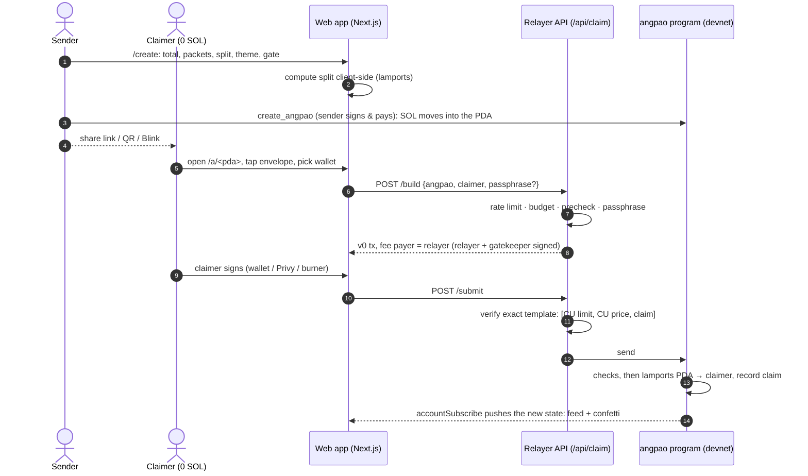

# 🧧 Onchain Angpao

Send red packets (angpao / hongbao / duit raya) on Solana. Pick a total, a number of packets, **Lucky** or **Equal** split and a greeting. Share a link, QR or Blink. Friends open a themed envelope and claim straight into a Solana wallet, even a brand-new one with **0 SOL**, because claims are **gasless**.

> 🎬 _Demo GIF goes here (`docs/demo.gif`)._

- **Lucky or Equal splits** up to 50 packets, with amounts fixed onchain at creation. Lucky uses the "double average" draw.
- **Gasless claims.** A relayer pays the fee and only ever signs one exact transaction shape.
- **Instant wallets** for people who don't have one: Privy embedded wallets (email/Google) when configured, otherwise an in-browser burner wallet. Android users also get Mobile Wallet Adapter.
- **Gates:** anyone with the link, a **passphrase** (the server co-signs), or an **invite list** of up to 50 wallets (enforced by the program).
- **Live claim feed** through a websocket account subscription, a countdown, a sold-out state and a 👑 for the luckiest packet.
- **Local currency** everywhere (MYR, SGD, IDR, USD, CNY) via CoinGecko, showing the value at creation and the value now.
- **8 themes:** Chinese New Year, Hari Raya, Deepavali, Christmas, Birthday, Wedding, Graduation and Custom. Each has greetings in English, Bahasa Melayu and 中文.
- **Sharing:** link, camera QR, Solana Pay wallet QR, Blink, WhatsApp/Telegram, and themed Open Graph previews.
- **Creator dashboard** with claim progress, **Refund & close** (after expiry or once sold out) and **Cancel** (before anyone claims).
- **No database.** All angpao state lives onchain, and Redis only holds rate-limit counters.

## How it works



Blinks (`/api/actions/angpao/<pda>`) and Solana Pay (`/api/pay/claim?angpao=<pda>`) reuse the same relayer-built transaction. The wallet adds the claimer's signature and broadcasts it itself. It can't change anything else, because that would break the relayer's signature.

## Solana for EVM developers

| Solana | Closest EVM idea | Here |
| --- | --- | --- |
| **Program** | Contract (code only, no storage of its own) | `anchor/programs/angpao` |
| **Account** | A storage slot / contract state, but a separate object with its own address | Each angpao is one account |
| **PDA** (program-derived address) | A `CREATE2`-style deterministic address the program controls, with no private key | `["angpao", creator, id]` holds the SOL |
| **Lamports** | Wei (1 SOL = 10⁹ lamports) | Amounts are `u64` lamports |
| **Rent** | Storage deposit | ≈0.006 SOL for 8 packets, refunded on close |
| **Fee payer** | `tx.origin` pays gas, but any signer can be the payer | The relayer pays, so claimers need 0 SOL |
| **Instruction** | A call; one tx can hold several | `[SetComputeUnitLimit, SetComputeUnitPrice, claim]` |
| **Compute units / priority fee** | Gas limit / tip | 30k CU at 10k µlamports per CU |
| **IDL + Codama** | ABI + typechain | `app/generated/angpao` |
| **Anchor** | Foundry/Hardhat + Solidity conveniences | Account validation, errors, events |
| **`accountSubscribe`** | `eth_subscribe` on storage | Live claim feed |
| **getProgramAccounts + memcmp** | An indexed event query | Dashboard: "angpaos where creator = me" |
| **Versioned (v0) tx, 1,232-byte limit** | Calldata limits | Caps packets at 50 |
| **Blink / Solana Action** | A shareable "transaction URL" | Claim button that unfurls in supported clients |

Inline `Solana note:` comments in the code explain these where they're used.

## Quickstart (local, against devnet)

Prerequisites: Node 22+, pnpm 10. Rust, the Solana CLI and Anchor 1.2.2 are needed only to build or deploy the program. The devnet program is already deployed.

```bash
pnpm install
cp .env.example .env.local
pnpm relayer:new           # writes RELAYER_SECRET_KEY to .env.local (never printed)
pnpm relayer:fund          # 1 SOL devnet airdrop, or: pnpm relayer:fund --from-cli 0.3
pnpm dev                   # http://localhost:3000
```

Connect a devnet wallet (Phantom, Solflare or Backpack set to devnet), get devnet SOL from [faucet.solana.com](https://faucet.solana.com), create an angpao, then open the link in a private window and claim with an instant wallet.

The public devnet RPC is rate-limited. For group demos, set `RPC_URL` and `NEXT_PUBLIC_RPC_URL` to a free Helius or Triton devnet endpoint.

Useful scripts:

| Script | What it does |
| --- | --- |
| `pnpm test` | Vitest: split, feed, gate and relayer-verifier cases (including malicious transactions) |
| `pnpm anchor:test` | Builds the program and runs the LiteSVM test suite |
| `pnpm smoke:create [packets] [sol] [pass:<p> \| allow:<a,b>]` | Creates a real devnet angpao with your Solana CLI wallet |
| `pnpm smoke:gasless <pda> [count] [url] [passphrase]` | Claims as N fresh 0-SOL wallets through the running app |
| `pnpm codama` | Regenerates the TS client from the IDL |

## Environment

Every variable is documented in [`.env.example`](.env.example). The ones that matter:

| Variable | Required | Notes |
| --- | --- | --- |
| `NEXT_PUBLIC_NETWORK` | – | `devnet` (default), `localnet` or `mainnet`. Mainnet also needs `NEXT_PUBLIC_ENABLE_MAINNET=true` |
| `NEXT_PUBLIC_PROGRAM_ID` | fork | Defaults to the ID in the IDL |
| `RPC_URL` / `NEXT_PUBLIC_RPC_URL` | recommended | Server RPC (may contain a key) / browser RPC |
| `RELAYER_SECRET_KEY` | for gasless | Base58 or JSON array. Keep only a small float on it |
| `RELAYER_DAILY_BUDGET_SOL` | – | Default 0.1, about 9,700 claims per day |
| `GATEKEEPER_SECRET_KEY` | – | Co-signs passphrase claims. Defaults to the relayer key |
| `UPSTASH_REDIS_REST_URL` / `_TOKEN` | **production** | Rate limits and budget. Without them the relayer refuses to run on Vercel |
| `COINGECKO_DEMO_API_KEY` | recommended | Free key. Keyless works only for light local use |
| `NEXT_PUBLIC_PRIVY_APP_ID` | – | Enables email/Google embedded wallets. Otherwise burner wallets are used |
| `NEXT_PUBLIC_SITE_URL` | production | Used for share links, Blink icons and OG images |
| `NEXT_PUBLIC_DEFAULT_FIAT` | – | `myr` by default |

## Deploy the program to devnet

```bash
solana config set --url devnet
solana airdrop 2                   # program deploys need ~2–3 SOL of rent
pnpm anchor:build
pnpm program:deploy:devnet
pnpm codama                        # if the IDL changed
```

## Fork guide (your own program and relayer)

1. **New program ID.** Generate your own keypair, so you're the upgrade authority:
   ```bash
   cd anchor
   solana-keygen new -o target/deploy/angpao-keypair.json --force
   anchor keys sync                 # updates declare_id! in lib.rs and Anchor.toml
   anchor build && cd ..
   ```
2. **Regenerate the client:** `pnpm codama`. Codama reads the new address from the IDL.
3. **Deploy:** `pnpm program:deploy:devnet`, then set `NEXT_PUBLIC_PROGRAM_ID=<your id>` (optional, since the IDL already carries it).
4. **Your own relayer:** `pnpm relayer:new --force && pnpm relayer:fund`. Never reuse someone else's key.
5. **Check it:** `pnpm smoke:create 3 0.01` prints a PDA. With `pnpm dev` running, `pnpm smoke:gasless <pda> 4` should land 3 claims and report the 4th as sold out.

## Deploy to Vercel

[](https://vercel.com/new/clone?repository-url=https%3A%2F%2Fgithub.com%2Fsachiew%2Fonchain-angpao&env=RELAYER_SECRET_KEY,NEXT_PUBLIC_SITE_URL,UPSTASH_REDIS_REST_URL,UPSTASH_REDIS_REST_TOKEN,COINGECKO_DEMO_API_KEY&envDescription=See%20.env.example%20for%20every%20variable)

1. Import the repo (or use the button). The framework is detected as Next.js and the install command as `pnpm install`.
2. Add an **Upstash Redis** database from the Vercel Marketplace (Storage tab). The app reads either `UPSTASH_REDIS_REST_URL` / `_TOKEN` or the `KV_REST_API_URL` / `_TOKEN` names it provisions.
3. Add the environment variables: `RELAYER_SECRET_KEY` (mark it **Sensitive**), `NEXT_PUBLIC_SITE_URL=https://<your-domain>`, `COINGECKO_DEMO_API_KEY`, and `RPC_URL` / `NEXT_PUBLIC_RPC_URL` for a reliable RPC.
4. Deploy, then check `https://<your-domain>/api/relayer`. It should return `"gasless": true`.

The program itself isn't deployed by Vercel. It lives on devnet (see above).

## Costs

| Who | What | Amount |
| --- | --- | --- |
| Sender | The packets themselves | Your total |
| Sender | Account rent deposit (**refunded on close**) | ≈0.0057 SOL (8 packets), ≈0.020 SOL (50), +0.0002 SOL per invited wallet |
| Sender | Create tx fee (+1 tx per 25 invitees) | ≈0.000005 SOL each |
| Relayer | Each claim (2 signatures + 300-lamport priority fee) | 10,300 lamports (≈0.00001 SOL). 15,300 if the gatekeeper is a separate key |
| Claimer | Nothing | 0 |

After expiry, or once sold out, **Refund & close** on `/dashboard` returns all unclaimed packets plus the rent.

## Mainnet notes

Mainnet is **off by default**. It needs `NEXT_PUBLIC_NETWORK=mainnet`, `NEXT_PUBLIC_ENABLE_MAINNET=true` and a mainnet deployment of the program, and the app then shows a permanent warning banner. Use small amounts. Gifting money with a game-of-chance split may be regulated where you live, so check your local rules. The program hasn't been audited.

## Limitations

- **The passphrase gate is demo-grade.** A salted hash sits onchain, so a short passphrase can be brute-forced offline. The server's co-signature is the real check, so use something long.
- **Invite lists** are capped at 50 wallets and take 1 + ⌈n/25⌉ signatures to create.
- **Lucky randomness is chosen by the sender's browser** at creation. The sender could pick a favourable split.
- **Burner wallets** keep their key in `localStorage`. Anyone with access to the browser can take the funds, so the UI pushes people to sweep to a real wallet.
- **A race on the last packet:** when several people claim it at once, the losing transactions fail onchain and the relayer still pays their fee (≈0.00001 SOL each). Preflight simulation filters most of them out.
- **Blinks** render in Blink-aware clients and on [dial.to](https://dial.to). Unfurling directly on X requires registering in the Dialect Actions registry. Blink requests made through a client's proxy share its IP for rate limiting.
- **Solana Pay QR** isn't offered for passphrase angpaos, because transaction requests can't ask for input.
- **The dashboard's "Closed" list** is per browser. Closed accounts are deleted onchain and leave only their transaction history.
- **OG images** fetch a CJK font subset from Google Fonts while rendering. If that fails, they fall back to Latin-only text.
- **Privy with an outside fee payer** hasn't been tested yet. Burner wallets are the fallback.

## Project structure

```
anchor/programs/angpao/src/   program: state, instructions/{create_angpao,set_allowlist,claim,refund_and_close,cancel}, errors, events
anchor/programs/angpao/tests/ LiteSVM tests
app/
  create/  a/[id]/  dashboard/          pages (a/[id] also has opengraph-image + metadata)
  api/claim/{build,submit}              gasless relayer
  api/actions/angpao/[id]  actions.json Blink
  api/pay/claim                         Solana Pay transaction request
  api/price  api/relayer                CoinGecko proxy, public relayer info
  generated/angpao/                     Codama client (generated, don't edit)
  lib/                                  split, fiat, themes, gate, feed, claim-tx, wallet/*, server/*
scripts/                                relayer + smoke scripts
tests/                                  vitest
```

## License

[MIT](LICENSE)
